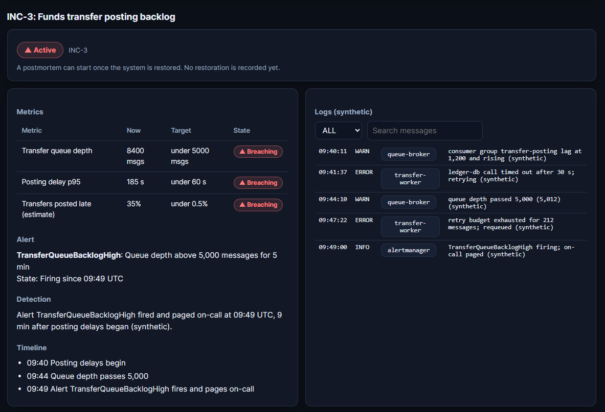
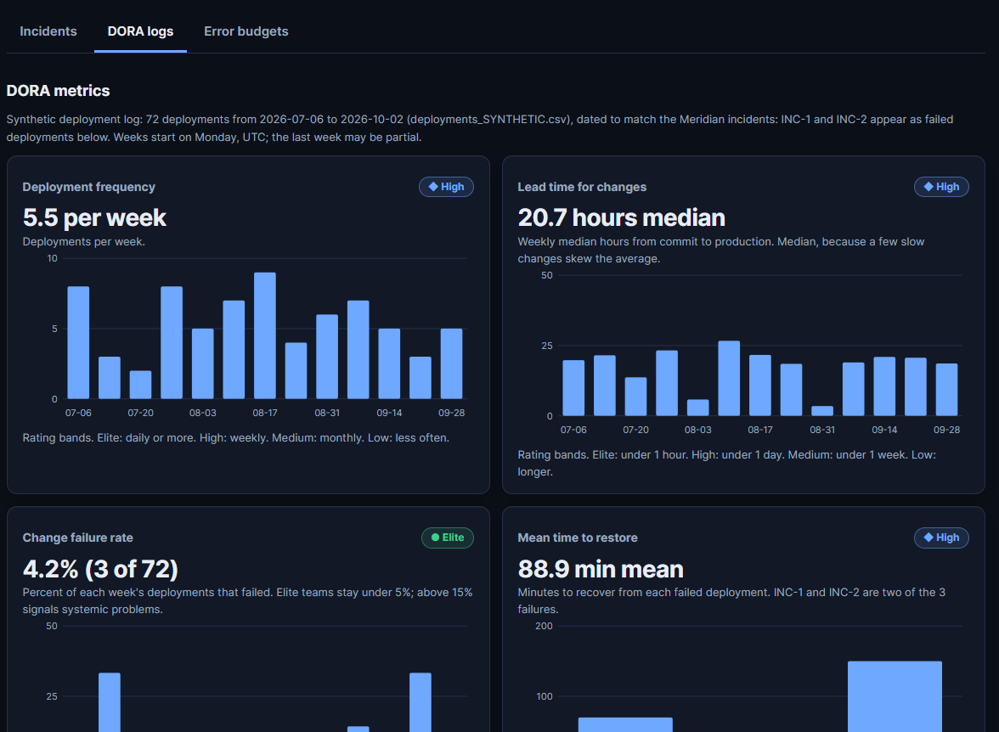
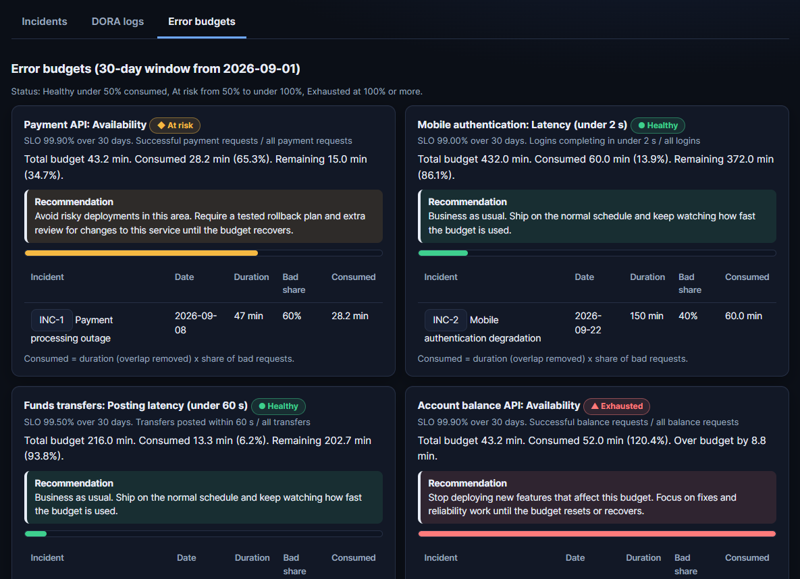
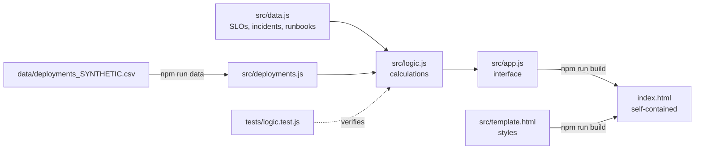
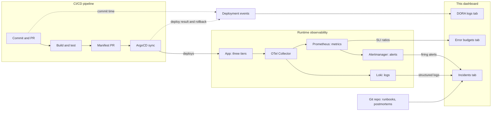

# Meridian Bank SRE Incident Dashboard

A working prototype of an incident, error budget, and DORA dashboard for a **fictional** regional bank. It is a portfolio piece that connects SRE practice (SLOs, runbooks, postmortems) with delivery metrics (DORA) and interface design. All data is synthetic or comes from my Meridian reliability coursework. It is not connected to any real system and is not production software.

To try it, open `index.html` in a browser. No install is needed.

## Project Summary
The dashboard gives an on-call engineer one place to answer the questions that matter during an outage: what is failing, what evidence supports that, what to do first, who to contact, and how much reliability budget is left. It has three tabs:

- **Incidents:** active and resolved incidents with metrics, structured logs, alerts, detection method, a matching runbook with checklists, and an escalation table that highlights who to contact.
- **DORA logs:** charts for deployment frequency, lead time, change failure rate, and mean time to restore, each rated Elite, High, Medium, or Low, above the 30 most recent deployments.
- **Error budgets:** 30-day budgets per SLO with the incidents behind each number and a recommendation by status.

Resolved incidents can start a blameless postmortem with a copyable summary and impact section and a downloadable blank template.

## Screenshots
All data shown is synthetic.

**Incident investigation (INC-3, active with a firing alert):** metrics against thresholds, the alert and detection method, a timeline, and searchable structured logs.



**DORA metrics:** four charts from 72 synthetic deployments, each with a rating (Elite, High, Medium, or Low) and its rating bands.



**Error budgets:** four SLOs in different states, each with a recommendation. The account balance budget is exhausted and shows how far over it is.



## Problem Statement
During an incident, engineers lose time moving between monitoring dashboards, runbooks, contact lists, and old postmortems. In a bank, the cost is higher: slow detection means failed payments, regulatory notifications, and a shrinking error budget that should be steering release decisions. Teams also tend to treat reliability data and delivery data as separate worlds, even though a bad release is often the cause of the outage.

This project asks: what would a single, fast view look like that connects an incident to its evidence, its runbook, its error budget, and its delivery history, and that makes the next decision (roll back, escalate, or stop shipping) obvious?

## Why I Built This
I wanted a project that shows how I think about reliability as an engineering and design problem, aimed at SRE and platform roles at fintech companies. My Meridian assignment produced the SLOs, error budget math, runbook, and postmortem; this project turns those documents into a working tool. It also lets me practice the habits I want to bring to a team: measuring before arguing, labeling uncertainty honestly, and writing tests for the numbers other people will rely on.

## Technologies Used
| Technology | Why I chose it |
|---|---|
| HTML5, CSS custom properties | Semantic markup, a dark theme that does not rely on color alone, and no build tooling needed to view the page. |
| Vanilla JavaScript | The interactions are small and the logic is the interesting part, so a framework would add weight without value. |
| Inline SVG | Four DORA charts without a charting library, with text labels for screen readers. |
| Node.js (built-in `node:test`) | Unit tests for the calculations with zero dependencies. |
| Node build scripts | Generate one self-contained `index.html` and convert the deployments CSV into a data module. |
| Mermaid | Architecture diagram that renders directly on GitHub. |

There are no runtime dependencies, no third-party scripts, and no network calls.

## Architecture Overview


| Layer | File | Responsibility |
|---|---|---|
| Data | `src/data.js`, `src/deployments.js` | Seed data. Nothing is hardcoded in the interface. |
| Logic | `src/logic.js` | Pure functions: error budgets, overlap handling, status detection, DORA metrics and ratings, related-postmortem matching, postmortem starter text. |
| Interface | `src/app.js`, `src/template.html` | Rendering, tabs, filters, copy buttons. |
| Build | `scripts/` | Produce `index.html` and `src/deployments.js`. |

Every number on screen is calculated from the same seed data, so the incident table, budget cards, and summaries cannot disagree. `index.html` is generated, so edit `src/` and rebuild.

## Where the Data Would Come From in a CI/CD Pipeline
The dashboard is the last step after the automation. In a real team, every number on screen would be produced by the delivery pipeline or the observability stack, not typed in. **None of the feeds below are built.** Today the dashboard reads seed data (`src/data.js`) and a CSV, shaped like these feeds so they can be swapped in later.



| Dashboard input | Today (implemented) | In a real pipeline (not built) | Example source |
|---|---|---|---|
| Deployment records for DORA | `data/deployments_SYNTHETIC.csv` | One event per deployment: commit time, deploy time, failed flag, recovery time | GitHub Actions and ArgoCD |
| SLI ratios and error budgets | Bad-request shares in `src/data.js` | Good and total request counts per SLO | Prometheus |
| Alerts and the firing indicator | Alert objects in `src/data.js` | Alerts that are currently firing | Alertmanager |
| Logs and trace IDs | Log entries in `src/data.js` | Structured logs with `trace_id` | Loki and OpenTelemetry |
| Runbooks and postmortems | `src/data.js` and the `.docx` template | Documents stored in the repository next to the code | Git (docs as code) |
| Escalation contacts | Fake contacts in `src/data.js` | The current on-call schedule | An on-call scheduling tool |

The deployments CSV already follows GitOps stages: its columns (`pr_review_wait`, `ci_checks`, `publish_image`, `manifest_bump_pr`, `argocd_sync_wait`, `rollout`) are the steps in the CI/CD box above, so lead time can be broken down by stage. The calculations in `src/logic.js` only need arrays of incidents and deployments, so a loader that fills those arrays from real sources would not require changing them.

## Observability Concepts Demonstrated
This project shows how observability data is **used** during an incident and in reliability decisions. It does not collect that data: there is no instrumentation, and all signals are simulated. The table maps each concept to where you can see it.

| Concept | Where it appears | What it shows |
|---|---|---|
| **Metrics** (is something wrong?) | Incidents tab, Metrics table | Each incident lists current value, threshold, and a Within target or Breaching label, such as queue depth 8,400 against a 5,000 limit. |
| **Structured logs** (what happened?) | Incidents tab, Logs panel | Entries with timestamp, severity, service, `trace_id`, and `request_id`. They can be filtered by severity, searched, and opened as JSON. |
| **Trace correlation** (where did it go wrong?) | Log entries | Logs carry a `trace_id` so a request could be followed across services. There is no trace or span view (see below). |
| **Saturation and data-tier signals** | INC-1 pool use, INC-3 queue depth | Resource-limit signals sit beside user-facing ones, because a full connection pool or queue often appears before users feel it. |
| **Error, rate, and duration signals** | Metrics and runbook thresholds | Error rate and request volume for INC-1, p95 latency and slow-request share for INC-3 and the runbook thresholds. |
| **Alerting with thresholds and duration** | Alert panel, runbook thresholds | Rules like "queue depth above 5,000 for 5 min", with a firing state shown in the incidents table and the overview. |
| **Symptom-based and cause-based alerts** | Runbook alert thresholds | Error rate, p95 latency, and a synthetic test payment are symptoms users feel. Pool use and queue depth point at likely causes. This grouping is my interpretation. |
| **Silent failure and detection gaps** | INC-1, INC-2, "Alerts firing" tile | INC-1 had no alert and was found by support after 13 minutes. INC-2's detection was never recorded. The overview says when active incidents have no firing alert. |
| **SLIs and SLOs** | Error budgets tab | Four SLIs defined as good events over total events (two availability, two latency), each with a target and a 30-day window. |
| **Error budgets and policy** | Error budgets tab | Budget in minutes, consumed and remaining, the incidents behind each number, and a recommendation by status (Healthy, At risk, Exhausted). |
| **MTTD and MTTR** | Error budgets tab, DORA tab | MTTD counts only incidents with a recorded detection time, and MTTR counts only resolved ones. Definitions are printed on screen. |
| **Runbooks and escalation** | Incidents tab, Runbook panel | Response steps, thresholds, and who to contact. Active incidents highlight the right contacts with a reason. A missing runbook is stated, not invented. |
| **Blameless postmortems** | Postmortem card, template download | Resolved incidents start a postmortem with a copyable summary and impact. Missing facts read "Unknown - requires human review." |
| **Evidence versus inference** | Related postmortems | Observed facts are shown separately from unconfirmed inferences, and the matching rule (shared tags only) is stated. |

### What is not covered
- **Distributed tracing:** there is a `trace_id` field but no trace viewer or span timeline.
- **Instrumentation:** nothing collects metrics, logs, or traces. The data-source diagram above shows where Prometheus, Loki, Alertmanager, and OpenTelemetry would feed the dashboard, but none of it is built.
- **Alert tuning:** thresholds are fixed examples, not tuned against real traffic.
- **Real-time data:** nothing updates live.

## Connection to Course Learning Objectives
This project is an SRE and observability artifact, so it connects most strongly to the reliability and metrics objectives (CLO4 and CLO5). It does not demonstrate the pipeline and infrastructure objectives (CLO2, CLO3, and most of CLO6), and I would rather say so plainly than stretch the claims.

| Objective | Connection | Status |
|---|---|---|
| **CLO1** Culture and foundations (Understand) | Blameless postmortem practice: the starter focuses on system conditions, marks unknowns instead of guessing, and never names individuals. The dashboard asks "what made this outage likely" and not "who caused it." Trunk-based development and platform engineering are not shown. | Partial |
| **CLO2** CI/CD pipelines with scanning, SBOM, signing (Apply) | No pipeline exists in this repository yet. A GitHub Actions workflow is the next step (see below). | Not demonstrated |
| **CLO3** IaC, Docker, GitOps on Kubernetes (Apply) | Not applicable to this artifact. See the reasons below. The data-source diagram shows where GitOps deployment events would feed the dashboard, but nothing is built. | Not applicable |
| **CLO4** DORA metrics, toil, branching (Analyze) | The DORA tab calculates deployment frequency, lead time, change failure rate, and mean time to restore from 72 deployments, rates each against bands, and ties two failed deployments to incidents. Toil is only indirectly addressed (the postmortem starter and copy buttons remove manual writing). Branching tradeoffs are not covered. | Mostly demonstrated |
| **CLO5** SLOs, error budgets, postmortems, observability (Evaluate) | Four SLIs and SLOs, calculated and tested error budgets with recommendations, postmortem starters, and detection gaps and MTTD that show how effective the observability is during an incident. See the concepts table above. | Demonstrated |
| **CLO6** Production-grade pipeline, supply chain security, progressive delivery (Create) | Comprehensive documentation, tests, and a small collaboration element (escalation to support and Compliance). No pipeline, supply chain controls, or progressive delivery. | Partial |

### Why some CI/CD elements are not applicable
- **Docker, Kubernetes, GitOps, and OpenTofu/Terraform:** the application is one static HTML page with no server, database, or runtime services. There is nothing to containerize, orchestrate, or provision, so adding these would be complexity without a purpose.
- **SBOM and artifact signing:** the project has no runtime dependencies and ships no container image or package. An SBOM would list nothing, and there is no artifact to sign. This keeps the supply chain risk small: the only tool outside the repository is Prettier, used for formatting on a developer machine.
- **Progressive delivery (canary, blue-green):** these control how a change reaches live traffic. This page has no live traffic or running service to roll out gradually.
- **Security scanning:** dependency scanning has nothing to scan. Secret scanning does apply, and I checked by hand that the repository has no credentials, but I have not automated it.

### Applicable but not built yet
A GitHub Actions workflow would apply directly: run the tests, confirm `index.html` matches `src/`, scan for secrets, and deploy to GitHub Pages only if those pass. That would demonstrate CLO2 at the scale this project allows and would give the first two boxes in the data-source diagram working code.

## Key Design Decisions
- **One dataset, pure calculations.** Incidents, budgets, and summaries all derive from `src/data.js` through functions in `src/logic.js`, which makes them testable and keeps the UI free of business rules.
- **Status is detected, not managed.** An incident is Resolved once a restoration time is recorded. I originally built a status stepper, then removed it, because an investigation tool should reflect the system's state and not ask the engineer to maintain a ticket.
- **The postmortem step appears only when the system is restored.** The "Start blameless postmortem" card shows for Resolved incidents only, so the workflow follows the real order of events.
- **Evidence over invention.** Missing facts show "Unknown - requires human review." MTTD excludes incidents with no recorded detection time, and MTTR counts only resolved incidents.
- **Honest labeling of "AI."** The summary is produced by local rules from recorded data. The card says no external model is called, and the logic sits behind one function so a real language model could replace it later.
- **Status carries meaning beyond color.** Pills pair color with an icon and a text label (Active, Resolved, At risk, Exhausted), and the active incident row has a colored edge.
- **Recommendations tied to budget status.** Healthy means business as usual, At risk means avoid risky deployments, Exhausted means stop new features and focus on fixes.
- **Who to contact, highlighted.** For active incidents, escalation rows are highlighted with a reason ("Logs show ledger database calls timing out"), so the person under pressure does not have to work it out.
- **A single self-contained page.** The build step inlines scripts, styles, and the postmortem template so the page works from a file, a preview, or GitHub Pages.

## Challenges and How I Solved Them
- **Blank page when opened on its own.** My first version loaded JavaScript from separate files, which a standalone preview could not find. I added a build script that inlines everything into one `index.html` and documented that `src/` is the source of truth.
- **Page jumping on every click.** The interface redraws after each action, which reset the scroll position. I now save and restore the scroll position on redraw, and I use smooth scrolling only for deliberate moves (switching tabs, opening an incident from a budget table). Smooth scrolling is turned off for people who prefer reduced motion.
- **Keeping numbers consistent.** Early on it was easy for a card and a table to show different values. I moved everything to one dataset, wrote the budget math as tested functions, and handled overlapping incidents on the same SLI so minutes are never counted twice.
- **Misleading averages.** MTTR first averaged in ongoing incidents. I changed it to resolved incidents only and print the definition next to the number.
- **Aligning delivery data with incidents.** The deployments CSV started as a separate dataset. I re-dated it to Q3 2026 and tied INC-1 and INC-2 to specific failed deployments, using the postmortem timeline for INC-1's recovery stages and leaving INC-2's unrecorded stages blank.
- **Demonstrating every state.** To show an Elite rating, I changed four non-incident failures in the synthetic data to successes. The README states this, and the original file is kept in `data/original/`.
- **Dead code after changing direction.** I removed the status stepper, draft editor, and unused fields once the design changed, and added a test that checks every incident links to a real SLO and an existing runbook.

## Outcomes and Metrics
These are results of the synthetic scenario and of the build itself, not measurements from a live system.

**Build quality**
- 15 automated tests passing, covering error budgets, overlap handling, status detection, DORA metrics and ratings, related-postmortem matching, postmortem text, and data consistency.
- 0 runtime dependencies, 0 external requests, and a self-contained page of about 100 KB.

**Error budgets (30-day window)**
| SLO | Budget | Consumed | Status |
|---|---|---|---|
| Payment API availability (99.9%) | 43.2 min | 28.2 min (65.3%) | At risk |
| Mobile authentication latency (99%) | 432 min | 60 min (13.9%) | Healthy |
| Funds transfers posting latency (99.5%) | 216 min | 13.3 min (6.2%) | Healthy |
| Account balance API availability (99.9%) | 43.2 min | 52 min (120.4%) | Exhausted |

**DORA metrics (72 synthetic deployments)**
| Metric | Value | Rating |
|---|---|---|
| Deployment frequency | 5.5 per week | High |
| Lead time for changes | 20.7 hours (median) | High |
| Change failure rate | 4.2% (3 of 72) | Elite |
| Mean time to restore | 88.9 minutes | High |

## Run It
`index.html` is self-contained. Open it in a browser, or run `npm start` and visit http://localhost:8000 (this uses Python's built-in web server). No environment variables are needed.

```
npm test        # unit tests (Node 18+)
npm run data    # regenerate src/deployments.js from data/deployments_SYNTHETIC.csv
npm run build   # regenerate index.html from src/
```

## How the Calculations Work
- **Error budget (minutes)** = (1 - SLO) x 30 days x 1,440. A 99.9% SLO gives 43.2 minutes.
- **Consumed** = incident duration (overlap with earlier incidents on the same SLI removed) x share of requests that were bad. An incident only affects the SLI it is linked to.
- **Status:** Healthy under 50% consumed, At risk from 50% to under 100%, Exhausted at 100% or more.
- **DORA ratings:** Elite and Low edges follow my course lesson (lead time and restore time under 1 hour for Elite; failure rate under 5% for Elite and 15% or more for Low). The middle bands are my assumption, based on DORA research, and are printed on each card.

## Data
| File | What it is |
|---|---|
| `src/data.js` | Services, SLOs, four incidents, two runbooks, and one postmortem. INC-1 and its numbers come from my assignment; INC-2 through INC-4 details are synthetic and labeled. |
| `data/deployments_SYNTHETIC.csv` | 72 synthetic deployments dated to Q3 2026. INC-1 and INC-2 are two of its three failed deployments. Four other failures from the original file were changed to successes. The original is in `data/original/`. |
| `templates/blameless-postmortem-template.docx` | Blank postmortem template, also embedded in the page for download. |

## Working on the Code
| To change... | Edit... |
|---|---|
| An incident, SLO, runbook, contact, or postmortem | `src/data.js` (the field guide is at the top of the file) |
| A calculation, threshold, or rating band | `src/logic.js`, then add or update a test in `tests/logic.test.js` |
| What a screen shows | `src/app.js`. One function per panel, grouped by tab, with the click actions listed in `actions` near the end |
| Colors, spacing, or layout | `src/template.html` |
| The deployment history | `data/deployments_SYNTHETIC.csv`, then `npm run data` |

After any change, run `npm test` and `npm run build`. `index.html` is generated, so never edit it directly. Code style is Prettier (`.prettierrc`); run `npm run format` before committing.

## Limitations
- All metrics, logs, and alerts are simulated, and bad-request shares are estimates.
- INC-2 is shown as ongoing so the Active state can be demonstrated, while the deployment data records its 150-minute recovery.
- Incident dates are in September 2026 and do not move with the calendar.
- Related-postmortem matching uses tags only, and the seed data has one postmortem.
- Only runbook checklist progress is saved in the browser. Everything else resets on reload.

## Security
No credentials, network calls, or third-party scripts. Text from the data is HTML-escaped before it is rendered. All contact details are fake and use the reserved `.example` domain.

## What I Would Build Next
- A Python backend with persistence for incident notes and saved postmortems.
- Live data from Prometheus, Loki, and Alertmanager, with OpenTelemetry traces linked from each log entry.
- A GitHub Actions pipeline that runs the tests, checks that `index.html` matches `src/`, and deploys to GitHub Pages only if both pass.
- Change events from a GitOps tool such as ArgoCD, so each incident links to the deployment that preceded it.
